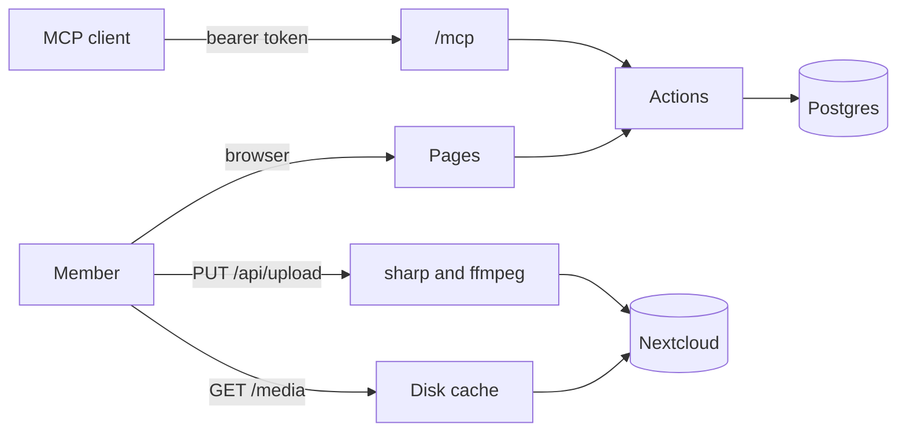

```
 ██████╗  █████╗ ██╗     ██╗     ███████╗██████╗ ██╗   ██╗
██╔════╝ ██╔══██╗██║     ██║     ██╔════╝██╔══██╗╚██╗ ██╔╝
██║  ███╗███████║██║     ██║     █████╗  ██████╔╝ ╚████╔╝
██║   ██║██╔══██║██║     ██║     ██╔══╝  ██╔══██╗  ╚██╔╝
╚██████╔╝██║  ██║███████╗███████╗███████╗██║  ██║   ██║
 ╚═════╝ ╚═╝  ╚═╝╚══════╝╚══════╝╚══════╝╚═╝  ╚═╝   ╚═╝
```

# WinLab Gallery

> The lab's photo wall for members: photos and short videos in Nextcloud, everything else in its own Postgres, and every action also an MCP tool.

`nextjs` `postgres` `nextcloud` `docker` `mcp`

[](https://github.com/NYCU-WinLab/gallery/actions) &nbsp;[](https://github.com/NYCU-WinLab/gallery/pkgs/container/gallery) &nbsp;[](#license)

WinLab members share lab photos here: upload from a phone, react, comment and tag. Only signed-in members see anything; every file passes through the app, which checks the session first.

```
> "What did we post from last year's orientation?"
  ⚡ list_photos { "tag": "迎新" }
✓ { "photos": [{ "name": "合照", "sequenceSize": 6, ... }], "nextOffset": null }
```

## What it does

- **Shows the wall**: newest taken first, pinned on top, photos uploaded together as one card, filtered by search, tag, uploader or favorites.
- **Takes uploads**: photos up to 30 MB (HEIC turns into JPEG) and videos up to 60 seconds and 100 MB (re-encoded to 720p H.264).
- **Stores files in Nextcloud** under one folder of one account, with a 480 px and a 2048 px WebP made at upload.
- **Lets members react, comment and tag**: 8 reactions, two-level comments, tags and favorites.
- **Serves MCP** at `/mcp`, with the gallery as the OAuth 2.1 authorization server.

## Deploy

With Docker Compose, on any machine with Docker:

```sh
curl -fsSLO https://raw.githubusercontent.com/NYCU-WinLab/gallery/main/compose.yaml
curl -fsSL -o .env https://raw.githubusercontent.com/NYCU-WinLab/gallery/main/.env.example
# set POSTGRES_PASSWORD, BETTER_AUTH_*, KEYCLOAK_* and NEXTCLOUD_* in .env
docker compose up -d
```

This starts Postgres, runs the migrations once, then serves the gallery from `ghcr.io/nycu-winlab/gallery` on `127.0.0.1:3000`.

> [!IMPORTANT]
> Put a reverse proxy with TLS in front, at the host in `BETTER_AUTH_URL`, and let it pass request bodies of 100 MB. MCP clients only accept an HTTPS resource, and the Keycloak redirect URI must match it.

## Use

1. In your Keycloak realm, create a confidential OpenID Connect client with the redirect URI `<BETTER_AUTH_URL>/api/auth/callback/keycloak`, and put its ID and secret in `.env`. Give its service account `view-users` so `/mcp` can check that a member still exists.
2. In Nextcloud, create an app password for the account that holds the files, create the folder `NEXTCLOUD_ROOT` in it, and put both in `.env`.
3. Open `BETTER_AUTH_URL` and sign in.
4. Make the first admin, once, after that member has signed in (later admins are added on /admins):

   ```sh
   docker compose exec postgres psql -U gallery -d gallery -c \
     "insert into admins (user_id) select id from users where username = '<their account>'"
   ```

5. Add the MCP server to a client, for example `claude mcp add --transport http gallery <BETTER_AUTH_URL>/mcp`, then ask it to call `whoami`.

## Configure

Set these in `.env`; [.env.example](.env.example) documents every one.

| Key | What it sets | Default |
|-----|--------------|---------|
| `POSTGRES_PASSWORD` | The database password, used by every service | required |
| `BETTER_AUTH_URL` | The public URL; the MCP resource is `<url>/mcp` | required |
| `BETTER_AUTH_SECRET` | Signs sessions and OAuth queries | required |
| `KEYCLOAK_ISSUER` | The realm URL, e.g. `https://auth.example.com/realms/lab` | required |
| `KEYCLOAK_CLIENT_ID`, `KEYCLOAK_CLIENT_SECRET` | The gallery's Keycloak client | required |
| `NEXTCLOUD_URL`, `NEXTCLOUD_USER`, `NEXTCLOUD_APP_PASSWORD` | Where the files live | required |
| `NEXTCLOUD_ROOT` | The folder in that account the gallery owns | `gallery` |
| `GALLERY_VERSION` | Image tag | `main` |
| `GALLERY_BIND`, `GALLERY_PORT` | Where web listens on the host | `127.0.0.1`, `3000` |
| `OTEL_EXPORTER_OTLP_ENDPOINT` | OTLP/HTTP endpoint for traces and error logs; off when empty | empty |

## How it works



An upload streams to a temp file, becomes an original plus two WebP sizes, and goes to Nextcloud as `<root>/<photo id>/`; only then is the row written. `/media/<id>/<thumb|large|original>` checks the session, keeps thumb and large on local disk after the first read, and streams originals with Range so videos seek. Only `lib/actions`, `lib/auth` and `lib/db` touch the database, and CI checks that every action is in the registry the MCP tools come from.

## Develop

```sh
bun install
cp .env.example .env.local   # point DATABASE_URL at a local Postgres
bun run db:migrate
bun run dev
```

Uploads need `ffmpeg` and `ffprobe` on the PATH. CI runs typecheck, lint, format, the design token check, the action registry check and a build, then builds the image and probes a real `docker compose up`. See [CLAUDE.md](CLAUDE.md) for the conventions.

## Limitations

- One web container: the media cache and upload temp files are on its own disk.
- Video re-encoding runs inside the upload request, so a 60 second clip takes a while on a small machine.
- No notifications: an @mention is plain text.

## Contributing

Issues and PRs welcome: start with [CONTRIBUTING.md](https://github.com/zyx1121/.github/blob/main/CONTRIBUTING.md).

## License

[MIT](LICENSE), made in a lab that keeps every group photo.
